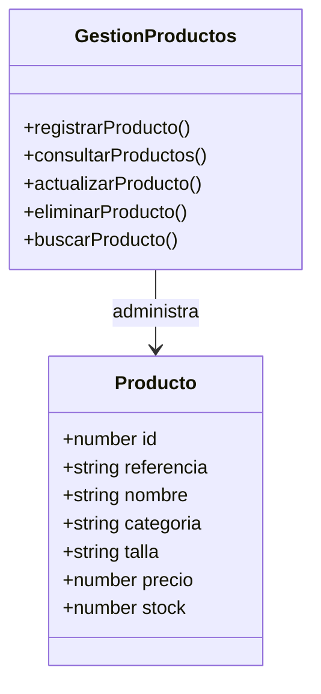

# Diagrama de clases - referencia para la codificación

## Relación con el código

La estructura `Producto` se representa en JavaScript mediante objetos con los atributos `id`, `referencia`, `nombre`, `categoria`, `talla`, `precio` y `stock`.

Las funciones de `App.jsx` implementan las operaciones principales de gestión del producto.
